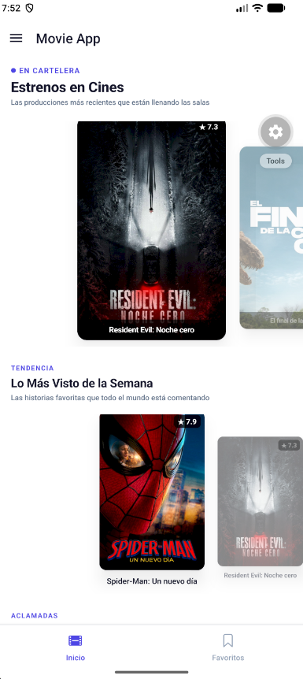
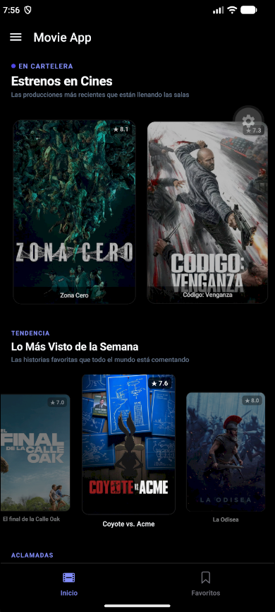
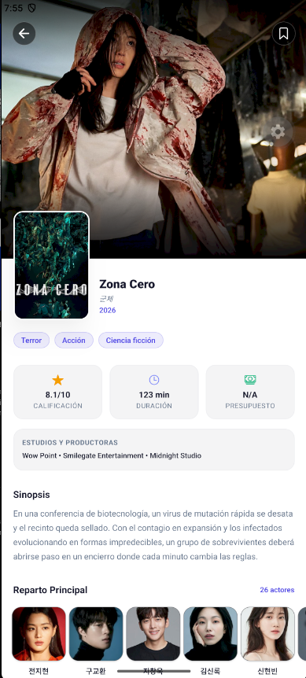
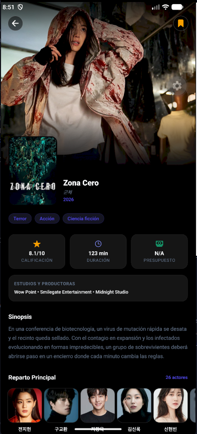
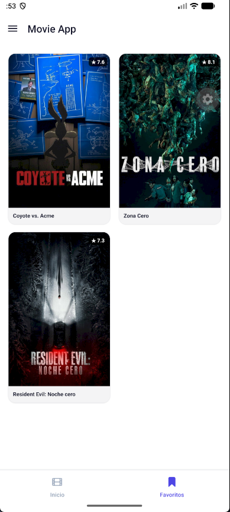
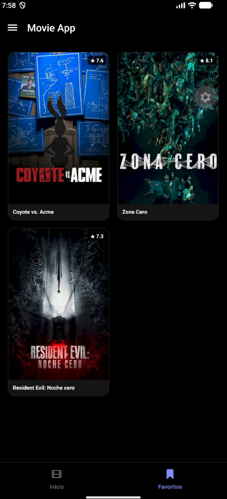
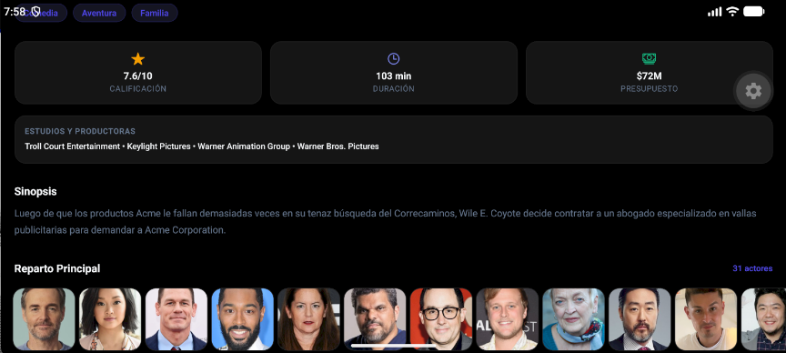
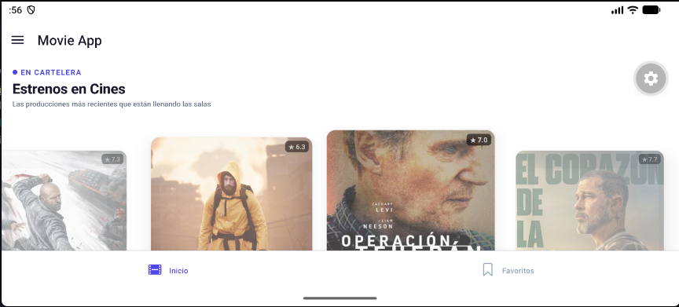
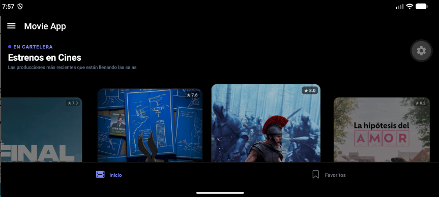

# 🎬 MovieApp Expo

Una aplicación móvil moderna, reactiva y de alto rendimiento construida con **React Native** y **Expo (SDK 57)**. Diseñada para explorar estrenos en cartelera, películas en tendencia, aclamadas por la crítica y próximos lanzamientos consumiendo la API oficial de **The Movie Database (TMDB)**. Cuenta con un sistema de favoritos persistente en almacenamiento local, soporte dinámico para orientación vertical y horizontal, tema claro/oscuro y navegación nativa mediante **Expo Router**.

---

## 📱 Vistas y Descripción Visual del Sistema

A continuación se detallan los módulos visuales y flujos clave de la aplicación, organizados por bloques funcionales según su proporción de pantalla (vertical / horizontal) y modo de visualización:

### 1. 🌓 Cartelera y Tema Adaptable (Vertical)

La pantalla principal adapta dinámicamente sus tokens de color (`background`, `surface`, `text`, `border`) según el esquema del sistema operativo (`light` o `dark`), sincronizado mediante utilidades atómicas de **NativeWind v4** y Tailwind CSS.

- **Implementación técnica:** En `src/app/_layout.tsx`, el proveedor raíz propaga el estado del tema reactivo a todos los navegadores anidados. Se incluyó `configureReanimatedLogger({ level: ReanimatedLogLevel.warn, strict: false })` a nivel modular para prevenir advertencias de lectura síncrona en Shared Values durante transiciones dinámicas entre modo claro y oscuro.

|                                Modo Claro (`home-light.png`)                                 |                                Modo Oscuro (`home-dark.png`)                                 |
| :------------------------------------------------------------------------------------------: | :------------------------------------------------------------------------------------------: |
|  |  |
|         _Diseño diurno de alto contraste con tipografía nítida y tarjetas elevadas._         |                _Esquema nocturno oscuro profundo diseñado para paneles OLED._                |

---

### 2. ⭐ Detalle y Favoritos Reactivos (Vertical)

Gestión completa de la ficha cinematográfica y del catálogo de películas guardadas, respaldado por reactividad en tiempo real y persistencia local sin autenticación externa.

- **Implementación técnica:**
  - **Ruta Dinámica Desacoplada (`src/app/movie/[id].tsx`):** Extrae parámetros mediante `useGlobalSearchParams` y valida rigurosamente el identificador (`Number(id) > 0`) antes de habilitar las consultas en `useMovie`. De este modo se evitan llamadas truncadas (`/movie/undefined`) a la API de TMDB.
  - **Reactividad en Zustand (`favorites.store.ts`):** En `MovieHeader.tsx`, el botón de favorito consulta reactivamente el store mediante `(state) => state.favorites.some(fav => Number(fav.id) === Number(id))`.
  - **Persistencia en Almacenamiento Local:** Los cambios se sincronizan automáticamente en el dispositivo con **AsyncStorage** mediante el middleware `persist`.
  - **Cuadrícula Responsiva (`src/app/(drawer)/(tabs)/(favorites)/index.tsx`):** Muestra el catálogo de películas guardadas con un diseño adaptativo de 2 columnas en modo vertical.

|                             Detalle de Película - Claro (`detail-light.png`)                             |                             Detalle de Película - Oscuro (`detail-dark.png`)                             |
| :------------------------------------------------------------------------------------------------------: | :------------------------------------------------------------------------------------------------------: |
|  |  |
|                  _Backdrop superior, póster flotante, géneros, presupuesto y sinopsis._                  |             _Vista de detalle en modo oscuro con métricas completas y toggle de favoritos._              |

|                             Colección de Favoritos - Claro (`favorites-light.png`)                             |                             Colección de Favoritos - Oscuro (`favorites-dark.png`)                             |
| :------------------------------------------------------------------------------------------------------------: | :------------------------------------------------------------------------------------------------------------: |
|  |  |
|                     _Cuadrícula vertical de favoritos con póster, calificación y título._                      |                    _Almacenamiento offline inmediato persistido a través de AsyncStorage._                     |

---

### 3. 🎞️ Scrolls Horizontales & Reparto (Tomas Panorámicas)

Presentación fluida de listas categorizadas (_En Cartelera_, _Tendencia_, _Joyas de la Crítica_, _Próximos Lanzamientos_) y carrusel de elenco.

- **Implementación técnica:**
  - **Listas Horizontales Paginadas (`MovieHorizontalList.tsx`):** Componente optimizado con `Animated.FlatList` conectado al hook `useInfiniteQuery` de TanStack Query. Al alcanzar el umbral `onEndReached`, solicita anticipadamente la página siguiente mediante `getNextPageParam`.
  - **Carrusel de Reparto (`MovieCast.tsx`):** Desplazamiento horizontal con tarjetas de actores y sus respectivos personajes, implementando renderizado progresivo y cacheo en disco mediante **Expo Image**.

|                          Scrolls Horizontales de Películas (`horizontal-scroll.png`)                           |
| :------------------------------------------------------------------------------------------------------------: |
|  |
|            _Exploración continua con snap suave y carga asíncrona de páginas subsecuentes de TMDB._            |

|                     Carrusel Horizontal de Elenco y Reparto (`cast-scroll.png`)                     |
| :-------------------------------------------------------------------------------------------------: |
|  |
|   _Avatares de actores con optimización de memoria, resolución adaptativa y transiciones suaves._   |

---

### 4. 📱 Soporte Landscape (Orientación Horizontal)

La aplicación aprovecha las dimensiones completas de la pantalla al girar el dispositivo, adaptando el layout para ofrecer una experiencia cinematográfica inmersiva sin desbordes.

- **Implementación técnica:**
  - **Configuración de Sensores (`app.json`):** Definido con `"orientation": "default"` para habilitar la detección bidireccional automática (Portrait y Landscape).
  - **Adaptación Responsiva:** Utiliza `useWindowDimensions()` para reorganizar la pantalla: la cuadrícula de favoritos pasa de 2 a 4 columnas y las listas horizontales amplían su área visible.
  - **Prevención de Crashes Nativos en Android:** Se implementó una clave única de orientación (`key={orientationKey}`), reinicio determinista del offset de scroll y memoización con `getItemLayout` en `MovieHorizontalList.tsx`, evitando excepciones de layout en el `ReactHorizontalScrollView` nativo durante el giro del dispositivo.

|                           Orientación Landscape - Modo Claro (`landscape-light.png`)                           |                           Orientación Landscape - Modo Oscuro (`landscape-dark.png`)                           |
| :------------------------------------------------------------------------------------------------------------: | :------------------------------------------------------------------------------------------------------------: |
|  |  |
|            _Aprovechamiento panorámico de pantalla en modo claro con ajuste dinámico de elementos._            |             _Visualización cinematográfica inmersiva en modo oscuro adaptada a pantalla completa._             |

> [!NOTE]
> **Nota sobre las capturas:** Todas las imágenes están enlazadas mediante rutas relativas (`./assets/readme-images/...`). Puedes visualizarlas en tu entorno de desarrollo con `Ctrl + Shift + V` en VS Code o directamente al publicar tu commit en GitHub.

---

## 🚀 Stack Tecnológico

| Capa / Herramienta               | Tecnología                            | Descripción                                                                                     |
| :------------------------------- | :------------------------------------ | :---------------------------------------------------------------------------------------------- |
| **Framework Base**               | **Expo SDK 57 / React Native 0.86**   | Arquitectura moderna con React 19 y Continuous Native Generation (CNG).                         |
| **Lenguaje**                     | **TypeScript 6.x**                    | Tipado estricto en todas las entidades, acciones, mappers y estados.                            |
| **Enrutamiento**                 | **Expo Router v57**                   | Enrutamiento declarativo basado en archivos con soporte nativo de Stacks, Tabs y Custom Drawer. |
| **Estilos & UI**                 | **NativeWind v4 (Tailwind CSS 3.4)**  | Utilidades de estilos atómicos con soporte nativo y temas Dark/Light en tiempo real.            |
| **Estado Global & Persistencia** | **Zustand + AsyncStorage**            | Store ultraligero con middleware `persist` para persistencia offline inmediata.                 |
| **Data Fetching & Caché**        | **TanStack Query v5 (React Query)**   | Paginación infinita (`useInfiniteQuery`), reintentos automáticos y recarga pull-to-refresh.     |
| **Cliente HTTP**                 | **Axios**                             | Cliente configurado con interceptores, baseURL y parámetros predeterminados de idioma.          |
| **Animaciones & Gestos**         | **React Native Reanimated v4 + RNGH** | Transiciones nativas a 60/120fps, parallax y carruseles fluidos.                                |
| **Optimización de Imágenes**     | **Expo Image**                        | Carga progresiva, cacheo en memoria/disco y transiciones suaves de pósters y backdrops.         |

---

## 🏛️ Arquitectura del Proyecto

El proyecto implementa una **Arquitectura Modular orientada a Features** (_Feature-Driven Architecture_), garantizando un alto desacoplamiento, escalabilidad y mantenibilidad.

```
movie-app/
├── assets/                       # Fuentes, animaciones e imágenes públicas
│   └── readme-images/            # Capturas de pantalla para documentación
├── src/
│   ├── app/                      # EXCLUSIVO: Capa de Enrutamiento (Expo Router)
│   │   ├── (drawer)/             # Contenedor principal con Drawer Navigator
│   │   │   ├── (tabs)/           # Bottom Tabs Navigator (Inicio, Favoritos)
│   │   │   │   ├── (favorites)/  # Pantalla de Favoritos persistentes
│   │   │   │   └── (movies)/     # Stack de Cartelera principal
│   │   │   └── settings/         # Pantalla de Ajustes de la aplicación
│   │   ├── movie/
│   │   │   └── [id].tsx          # Stack independiente para el Detalle de Película
│   │   ├── _layout.tsx           # Layout Raíz (QueryClient, StatusBar, SafeAreas)
│   │   └── index.tsx             # Redireccionamiento inicial seguro
│   │
│   ├── features/                 # Lógica de Negocio y Dominio desacoplada
│   │   ├── movies/               # Dominio de Películas
│   │   │   ├── actions/          # Peticiones asíncronas a TMDB (now-playing, popular, etc.)
│   │   │   ├── components/       # Componentes de presentación (MovieHeader, MovieCast, etc.)
│   │   │   ├── hooks/            # Hooks de lógica de consumo (useMovies, useMovie)
│   │   │   ├── interfaces/       # Contratos y tipos TypeScript de respuestas y entidades
│   │   │   └── mappers/          # Mappers de transformación de payloads API a UI
│   │   │
│   │   ├── favorites/            # Dominio de Favoritos
│   │   │   └── store/            # Store persistente de Zustand (favorites.store.ts)
│   │   │
│   │   └── profile/              # Dominio de Perfil
│   │       └── components/       # Cabecera de usuario en Drawer (DrawerUserHeader)
│   │
│   └── shared/                   # Código compartido entre múltiples features
│       ├── api/                  # Instancia global de Axios (movie-api.ts)
│       ├── components/           # Primitivas comunes (SectionHeader, LoadingScreen, etc.)
│       └── constants/            # Paleta de colores, métricas y constantes del tema
│
├── app.json                      # Configuración de Expo y sensores de orientación
├── tailwind.config.js            # Configuración de diseño y colores para NativeWind
└── tsconfig.json                 # Configuración del compilador TypeScript y path aliases (@/*)
```

> [!IMPORTANT]
> **Sin Barrel Files (`index.ts` centralizadores):** Las importaciones se realizan apuntando directamente a cada módulo o componente. Esto previene ciclos de dependencia inesperados, reduce el consumo de memoria en desarrollo y maximiza la eficiencia del _tree-shaking_ de Metro Bundler.

---

## ✨ Características Principales

- **🎞️ Cartelera en Tiempo Real ("Now Playing"):** Carrusel principal interactivo con diseño Parallax y listas de scroll horizontal dinámico.
- **📈 Exploración Paginada con Infinite Scroll:** Secciones diferenciadas para películas en _Tendencia_, _Mejor Valoradas_ y _Próximos Estrenos_, consumiendo páginas subsecuentes conforme el usuario se desplaza.
- **🔄 Recarga Proactiva (Pull-to-Refresh):** Invalidación global de caché de TanStack Query deslizando hacia abajo en la pantalla principal.
- **📄 Detalle Completo de Película (`/movie/[id]`):**
  - Backdrop superior en alta resolución con degradados de inmersión.
  - Póster superpuesto flotante, título original y año de estreno.
  - Badges de géneros cinematográficos.
  - Tarjetas con métricas de recaudación, presupuesto, duración y casas productoras.
  - Carrusel horizontal con el reparto de actores y personajes (`MovieCast`).
- **⭐ Colección de Favoritos Persistente:**
  - Agregar o remover películas al instante con selector reactivo en Zustand.
  - Sincronización automática en almacenamiento persistente (`AsyncStorage`).
  - Vista dedicada en Tab Bar con cuadrícula inteligente (2 columnas en vertical, 4 columnas en horizontal).
- **📱 Rotación Dinámica de Pantalla (Orientation-Ready):**
  - Soporte fluido para modo vertical (_Portrait_) y horizontal (_Landscape_).
  - Recálculo reactivo con `useWindowDimensions()` evitando desbordes o bloqueos de layout en Android/iOS.
- **🌓 Tema Adaptable (Claro / Oscuro):** Detección automática del esquema de color del sistema mediante NativeWind.

---

## 🛠️ Instalación y Puesta en Marcha

### Prerrequisitos

- [Node.js](https://nodejs.org/) (versión 18 o superior recomendada).
- Gestor de paquetes: [pnpm](https://pnpm.io/) (recomendado en este proyecto) o `npm`.
- Cuenta y API Key gratuita en [The Movie Database (TMDB)](https://www.themoviedb.org/documentation/api).
- Aplicación **Expo Go** instalada en tu dispositivo físico (Android o iOS) o un emulador configurado.

### 1. Clonar el Repositorio

```bash
git clone https://github.com/tu-usuario/movie-app.git
cd movie-app
```

### 2. Instalar Dependencias

```bash
pnpm install
# o con npm:
# npm install
```

### 3. Configurar Variables de Entorno

Copia el archivo de plantilla `.env.template` a un nuevo archivo `.env`:

```bash
cp .env.template .env
```

Abre `.env` y agrega tu API Key de TMDB:

```env
# https://www.themoviedb.org/settings/api
EXPO_PUBLIC_MOVIE_DB_KEY=tu_api_key_aqui
EXPO_PUBLIC_MOVIE_DB_URL=https://api.themoviedb.org/3/movie
```

### 4. Iniciar el Servidor de Desarrollo

```bash
npx expo start
```

- Escanea el código QR desde la app **Expo Go** en tu dispositivo físico.
- Presiona `a` para abrir en el emulador de **Android**.
- Presiona `i` para abrir en el simulador de **iOS**.

---

## 🧪 Scripts Disponibles

| Comando            | Acción                                                                    |
| :----------------- | :------------------------------------------------------------------------ |
| `pnpm start`       | Inicia el servidor de desarrollo de Metro con Expo.                       |
| `pnpm android`     | Lanza directamente la aplicación en un emulador Android conectado.        |
| `pnpm ios`         | Lanza directamente la aplicación en el simulador de iOS (requiere macOS). |
| `pnpm lint`        | Ejecuta el análisis estático de código mediante ESLint.                   |
| `npx tsc --noEmit` | Realiza la comprobación estricta de tipos de TypeScript.                  |

---

## 📄 Licencia

Todos los derechos reservados (Proprietary / Closed Source): Prohibida su copia, distribución o uso comercial sin autorización expresa del autor.
